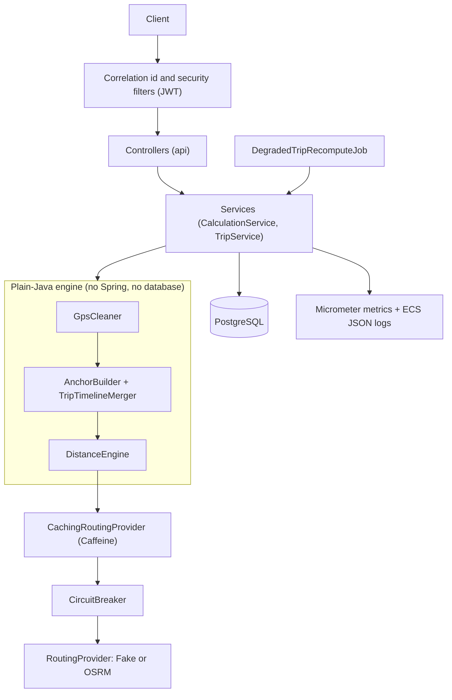

# GPS Distance Reconstruction Engine

A Java backend that rebuilds the billable distance of a cab trip from noisy GPS pings, pickup/drop milestones and the office location. Every kilometre in the result is labelled with the rule that produced it, so a vendor dispute can be answered segment by segment.

**Stack:** Java 21 · Spring Boot 3.5 · PostgreSQL 17 · Spring Security (JWT) · Caffeine · Micrometer · Docker Compose

**Demo video:** `https://drive.google.com/drive/folders/1ZOFutejrquHpHKkVAqTx98Vto_yRPTMX?usp=drive_link`

[Overview](#overview) · [Quick start](#quick-start) · [API](#api) · [How distance is calculated](#how-distance-is-calculated) · [Architecture](#architecture) · [Resilience and billing](#resilience-and-billing) · [Security](#security) · [Monitoring](#monitoring) · [Testing](#testing) · [Benchmarks](#benchmarks) · [Design decisions](#design-decisions-and-limitations) · [Documentation](#documentation)

---

## Overview

Vendors are paid per kilometre, but cab GPS is unreliable: tunnels, duplicate pings, late pings and bad fixes. Adding up the distance between pings under-pays the vendor. Asking a routing API for every gap over-pays on noisy data and costs a lot of API calls.

For each trip the engine:

1. **Cleans the pings:** removes duplicates, sorts by time, drops low-accuracy fixes and impossible jumps (default limit 120 km/h).
2. **Adds anchor points:** actual or fallback pickup/drop points, optional no-show points, and the office point (actual trip end only if within 400 m of the planned office).
3. **Measures each segment** with the cheapest valid rule: straight line, parked, or routing provider.
4. **Labels every segment** with a rule and a plain-English reason.
5. **Survives failures:** if the routing provider is down, it falls back to straight line × 1.4, marks the trip `DEGRADED`, and recomputes it automatically after recovery.
6. **Protects closed invoices:** late pings never change a billed result. The difference is stored as a signed adjustment (for example `+1.800 km`).

---

## Quick start

**Prerequisites:** Docker Desktop and Git. (Java 21 is only needed to run the tests outside Docker.)

```powershell
git clone <repository-url>
cd gps-distance-reconstruction-engine
cp .env.example .env
```

Open `.env` and set the secrets. Generate a JWT secret with:

```powershell
$b = New-Object byte[] 48
[System.Security.Cryptography.RandomNumberGenerator]::Create().GetBytes($b)
[Convert]::ToBase64String($b)
```

Minimum `.env` values (plain `NAME=value` lines, no quotes):

```text
JWT_SECRET=<generated value>
SEED_PASSWORD=<your own password, at least 12 characters>
AUTH_SEED_ENABLED=true
```

Start everything with one command:

```powershell
docker compose up --build -d
docker compose ps
```

The API is at `http://localhost:8081`. Verify it:

```powershell
Invoke-RestMethod http://localhost:8081/actuator/health
```

Run the end-to-end smoke test (needs `SEED_PASSWORD` in the session, see the loader line in the next section):

```powershell
.\scripts\smoke-test.ps1 -BaseUrl "http://localhost:8081"
```

Stop with `docker compose down`. Add `-v` to delete the database volume.

**Seeded users** (only when `AUTH_SEED_ENABLED=true`; the password is your `SEED_PASSWORD`):

| User | Role | Tenant |
|---|---|---|
| `admin-a` | ADMIN | tenant-a |
| `operator-a` | OPERATOR | tenant-a |
| `employee-a` | EMPLOYEE | tenant-a |
| `operator-b` | OPERATOR | tenant-b |

---

## API

All endpoints are under `/api/v1` and use JSON. Except login, every call needs `Authorization: Bearer <token>`. The tenant comes from the token, never from the client.

| Method | Path | Purpose | Roles |
|---|---|---|---|
| POST | `/auth/login` | Get a 15-minute JWT | public |
| POST | `/trips` | Create a trip (201) | OPERATOR, ADMIN |
| POST | `/trips/{id}/pings` | Upload raw GPS pings (1–10,000 per call) | OPERATOR, ADMIN |
| POST | `/trips/{id}/milestones` | Upload start, end, pickup, drop, no-show | OPERATOR, ADMIN |
| POST | `/trips/{id}/calculations` | Calculate or recompute: 201 new, 200 reused | OPERATOR, ADMIN |
| GET | `/trips/{id}` | Trip details, latest result, billing summary | OPERATOR, ADMIN; EMPLOYEE (own trips, reduced view) |
| GET | `/trips/{id}/calculations` | Calculation history | OPERATOR, ADMIN |
| GET | `/trips/{id}/calculations/{calcId}/segments` | Segment-level results | OPERATOR, ADMIN |
| GET | `/trips/{id}/billing-adjustments` | Signed adjustments after billing | OPERATOR, ADMIN |
| POST | `/trips/{id}/close-invoice` | Freeze the billed result | ADMIN |

Another tenant's resource always returns **404**, never 403. Errors share one JSON shape with a `correlationId`; they never contain coordinates, employee references or tokens.

### Example walkthrough (PowerShell)

```powershell
# Load .env values into this session (does not print them)
Get-Content .env | Where-Object { $_ -match '^\s*[A-Za-z_][A-Za-z0-9_]*=' } | ForEach-Object { $k,$v = $_ -split '=',2; Set-Item -Path "env:$k" -Value $v.Trim() }

$base = "http://localhost:8081"
$token = (Invoke-RestMethod -Method Post -Uri "$base/api/v1/auth/login" -ContentType "application/json" `
  -Body (@{ username = "operator-a"; password = $env:SEED_PASSWORD } | ConvertTo-Json)).accessToken
$h = @{ Authorization = "Bearer $token" }

$trip = Invoke-RestMethod -Method Post -Uri "$base/api/v1/trips" -Headers $h -ContentType "application/json" -InFile docs\samples\create-trip.json
Invoke-RestMethod -Method Post -Uri "$base/api/v1/trips/$($trip.id)/pings" -Headers $h -ContentType "application/json" -InFile docs\samples\upload-pings.json
Invoke-RestMethod -Method Post -Uri "$base/api/v1/trips/$($trip.id)/milestones" -Headers $h -ContentType "application/json" -InFile docs\samples\upload-milestones.json

$calc = Invoke-RestMethod -Method Post -Uri "$base/api/v1/trips/$($trip.id)/calculations" -Headers $h
$calc | Format-List
```

Example response (values depend on the input data):

```json
{
  "status": "CALCULATED",
  "ruleVersion": "2026.1",
  "totalMeters": 1076,
  "totalKm": 1.076,
  "reused": false
}
```

The response also reports `routingProviderCalls`, `cacheHits` and `cacheMisses` for the trip. Calling calculate again with unchanged data returns `reused: true` and stores nothing new.

---

## How distance is calculated

**Pipeline:** clean pings → build anchors → merge into one timeline → fingerprint → measure each consecutive pair.

**Segment rules**, checked in this fixed order (the order is part of the versioned design):

| # | Rule | Condition | Distance |
|---|---|---|---|
| 1 | `SHORT_GAP_AERIAL` | gap < 70 s and speed ≤ limit | straight line |
| 2 | `PARKED` | gap ≥ 70 s and speed < 5 km/h | straight line |
| 3 | `REJECTED_SPEED` (pre-check) | even the straight line is faster than the limit | 0 m, no provider call |
| 4 | `ROUTED` | otherwise ask the provider; accepted if valid | provider distance |
| 5 | `REJECTED_MAX_DISTANCE` | routed distance > 100 km | 0 m |
| 6 | `REJECTED_SPEED` | routed speed > limit **and** straight line × 1.4 speed > limit | 0 m |
| 7 | `FALLBACK_AERIAL_1_4` | provider failed or returned an invalid value | straight line × 1.4, trip marked `DEGRADED` |

Every segment stores its rule and a short reason (numbers only, never coordinates).

**Units and rounding:** calculations run in `double` (metres, km/h). Each segment is rounded **once** to whole metres and stored as a `long`. The trip total is the sum of those integers, so the same input and rule version always give exactly the same kilometres. Kilometres are derived from integer metres with `BigDecimal` (3 decimals).

**Determinism and versioning:** the result is tied to `RULE_VERSION` (currently `2026.1`) and a SHA-256 fingerprint of the cleaned timeline plus the active configuration. Noise that cleaning removes (duplicates, bad fixes) does not change the fingerprint, so it never creates a new calculation.

**Complexity** (n = pings, m = anchors): sorting O(n log n), everything else O(n + m); memory O(n + m) per trip.

---

## Architecture



| Package | Responsibility |
|---|---|
| `api` | Controllers and request/response records; no business logic |
| `service` | Transactions, orchestration, billing rules |
| `engine` | Cleaning, anchors, Haversine, segment rules, fingerprint (plain Java, tested without Spring) |
| `routing` | `RoutingProvider` interface, fake and OSRM implementations, cache, circuit breaker |
| `domain`, `repository` | JPA entities and Spring Data repositories |
| `job` | Scheduled recomputation of `DEGRADED` trips |
| `security`, `config`, `error` | JWT and roles, configuration beans, global error handling |

Full diagrams, including the sequence diagram of the hardest flow and the failure-mode table, are in [docs/DESIGN.md](docs/DESIGN.md).

---

## Resilience and billing

- **Provider failure:** the circuit breaker opens, segments fall back to straight line × 1.4, and the trip is `DEGRADED`. Cache hits are still served while the breaker is open.
- **Automatic recovery:** a scheduled job retries `DEGRADED` trips once the breaker allows calls, and stops its run if the provider is still unhealthy.
- **Idempotent recompute:** same input and rule version give the same calculation. Duplicate requests reuse the stored result.
- **Closed invoices:** after `close-invoice`, the billed calculation is never modified. A recalculation with new pings stores a new calculation and a `BillingAdjustment` with the signed difference. `payable = billed + sum(adjustments)`. Only `CALCULATED` results reach billing, never `DEGRADED` estimates.
- **Concurrency control:** a row lock on the trip serialises decisions, database unique constraints guarantee no duplicates even if code is wrong, and `@Version` catches update paths that skip the lock. The engine runs outside the database transaction so a slow provider never holds a connection.

---

## Security

- JWT (HS256) signed with `JWT_SECRET`; the app refuses to start without a strong secret. Tokens last 15 minutes; there are no refresh tokens.
- Passwords are stored as BCrypt hashes. Wrong password, unknown user and disabled user return the same 401.
- Roles: `EMPLOYEE` (reduced view of own trips), `OPERATOR` (trip lifecycle and calculation), `ADMIN` (everything, plus invoice closing and metrics).
- Tenant isolation: tenant comes only from the signed token, every query is tenant-scoped, and cross-tenant access returns 404.
- Logs, errors and metric tags never contain coordinates, employee references, tokens or passwords (covered by automated tests).
- The container runs as a non-root user, and no secrets are baked into the image.

---

## Monitoring

- **Logs:** structured JSON (Elastic Common Schema) in Docker, with `correlationId`, `tenantId` and an opaque `userId` on each line.
- **Metrics:** `/actuator/metrics` (ADMIN only) exposes `gps.*` metrics. `/actuator/health` is public and shows status only.

| What to watch | Metric |
|---|---|
| Provider health | `gps.routing.breaker.state` (0 closed, 1 half-open, 2 open), `gps.routing.provider.failures` |
| Degraded backlog (queue depth) | `gps.degraded.trips` |
| Recovery lag | `gps.degraded.oldest.age.seconds`, `gps.recompute.last.success.age.seconds` |
| Cost | `gps.routing.provider.calls`, `gps.routing.cache` (tag `result=hit\|miss\|bypass`) |
| Rejections | `gps.calculation.segments` (tag `rule`) |
| Errors | `http.server.requests` (tag `status`), `gps.errors.unexpected` |

```powershell
Invoke-RestMethod "$base/actuator/metrics/gps.routing.breaker.state" -Headers $adminHeaders
```

The incident checklist is in [docs/RUNBOOK.md](docs/RUNBOOK.md). Alert thresholds there are suggestions; there is no alerting system in this project.

---

## Testing

```powershell
.\mvnw.cmd test                              # full suite (Docker Desktop must be running)
.\mvnw.cmd test "-Dgroups=unit"              # plain Java, no Docker
.\mvnw.cmd test "-Dgroups=concurrency"
.\mvnw.cmd test "-Dgroups=failure-injection"
```

Last full run: **243 tests, 0 failures, 0 errors, 1 skipped**.

| Tag | Tests | What it proves |
|---|---|---|
| `unit` | 116 | Cleaning, anchors, segment rules, fingerprint, cache, breaker |
| `integration` | 106 | API, security, persistence against real PostgreSQL (Testcontainers) |
| `failure-injection` | 9 | Provider failure, timeouts, rollback, recovery |
| `concurrency` | 4 | Simultaneous calculation, cache stampede, close-invoice races |

A test can carry more than one tag. Every hard rule is mapped to a test in [docs/REQUIREMENTS_TRACEABILITY.md](docs/REQUIREMENTS_TRACEABILITY.md); how to run each group is in [docs/TESTING.md](docs/TESTING.md).

**Not tested:** a real OSRM server (the OSRM client is tested against a local fake HTTP server), several application instances, and browser clients.

---

## Benchmarks

Measured on: AMD Ryzen (12 logical cores), 16 GB RAM, Windows 11, plugged in, Java 21, `-Xmx512m`. Full output: [docs/benchmarks/results-latest.md](docs/benchmarks/results-latest.md). Numbers will differ on other machines.

**Engine benchmark (no database, fake provider with zero latency):** 10,000 synthetic trips of about 1,500 pings each (about 15 million pings), 12 threads, cache enabled.

| Metric | Value |
|---|---|
| Throughput | 1,538.1 trips/s (2,307,101 pings/s) |
| Per-trip pipeline latency | p50 5.7 ms, p95 17.3 ms, p99 33.0 ms |
| Peak heap | 249 MB |
| GC time | 405 ms in total |
| Cache hit rate | 34.4% |
| Accuracy cost of caching | 0.0102% difference in total distance versus no cache |
| Determinism | identical checksum for single-thread and 12-thread runs |

**Provider calls before and after caching:**

| Run | Provider calls | Calls per trip |
|---|---|---|
| Cache disabled | 24,960 | 2.50 |
| Cache enabled | 16,374 | 1.64 |

**Failure halfway through:** 10,000 trips evaluated; 5,719 calculated, 4,281 degraded, 0 lost, 4,281 (100%) recovered after healing.

**End-to-end benchmark (HTTP, security, PostgreSQL):** run at a reduced scale of 200 trips (50,000 pings, 4 client threads); results in the results file. Nothing is extrapolated to 10,000 trips.

Where the system stops scaling, theoretical limits, and how to reproduce are in [docs/PERFORMANCE.md](docs/PERFORMANCE.md).

---

## Design decisions and limitations

**Assumptions resolved**

| Question | Decision |
|---|---|
| What is a duplicate? | Same trip, timestamp and coordinates (6 decimals) |
| Low accuracy | Worse than 50 m is dropped (configurable) |
| Teleport check | Compared with the last accepted ping |
| Rejected segments | Count as 0 km, labelled with the reason |
| Cache key | Start and end snapped to a ~100 m grid; the provider is asked about cell centres so results never depend on request order |
| Billing | Only `CALCULATED` results; late pings produce signed adjustments |

**Trade-offs** (details in [docs/TRADEOFFS.md](docs/TRADEOFFS.md))

- Strong consistency for billing (row lock per trip) over maximum write throughput.
- Availability during provider outages (fallback plus `DEGRADED`) over exact distances at all times.
- Cache cell snapping costs a small accuracy in exchange for deterministic results and fewer provider calls.
- In-process Caffeine instead of Redis, and a hand-written circuit breaker instead of a library, to stay simple and easy to explain.

**Deliberately left out:** Kafka, microservices, Redis, rate limiting on login, refresh tokens and revocation, user-management API, Flyway migrations, leader election for the recompute job, row-level security in the database, a frontend.

**Known limitations**

- The OSRM client has not been verified against a real OSRM server.
- `ddl-auto=update` is used instead of migrations.
- The recompute job assumes one application instance. More instances stay correct but may duplicate provider calls.
- Entity ids use `IDENTITY`, which prevents JDBC batch inserts and limits ingest speed.
- The demo fault-injection endpoint exists only when `DEMO_FAULT_INJECTION=true` and the fake provider is active. It is off by default and must stay off in any real deployment.

---

## Project structure

```text
.
├── src/main/java/com/example/gpsengine/   api, service, engine, routing, domain, repository, job, security, config, error
├── src/test/java/com/example/gpsengine/   unit, integration, concurrency, failure-injection, benchmark
├── docs/                                  design, runbook, testing, performance, samples, benchmark results
├── scripts/                               smoke-test.ps1
├── postman/                               Postman collection
├── Dockerfile
├── compose.yaml
└── .env.example
```

---

## Documentation

| Document | Contents |
|---|---|
| [docs/DESIGN.md](docs/DESIGN.md) | Architecture diagram, sequence diagram, failure-mode table, data model |
| [docs/TRADEOFFS.md](docs/TRADEOFFS.md) | Consistency vs availability vs latency, what was left out |
| [docs/TESTING.md](docs/TESTING.md) | How to run each test group |
| [docs/REQUIREMENTS_TRACEABILITY.md](docs/REQUIREMENTS_TRACEABILITY.md) | Every rule and evaluative plus point mapped to tests |
| [docs/PERFORMANCE.md](docs/PERFORMANCE.md) | Complexity, empirical benchmarks, and reproduction instructions |
| [docs/PROJECT_BRIEF.md](docs/PROJECT_BRIEF.md) | Original assessment brief and problem specification |
