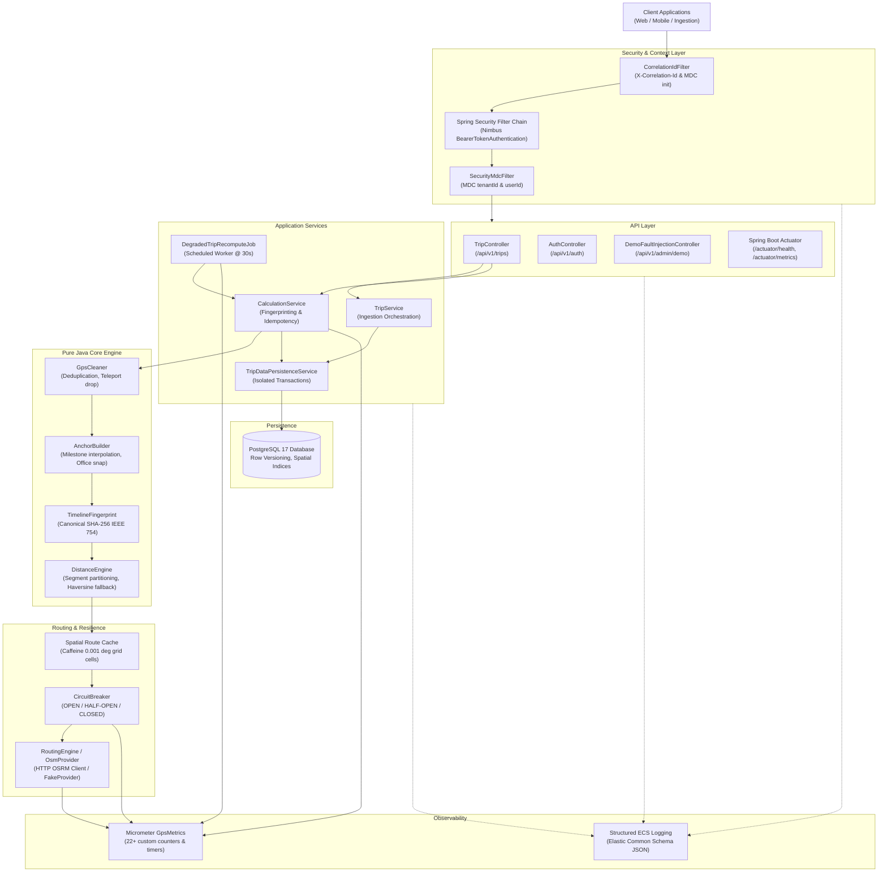

# GPS Distance Reconstruction Engine

> **Carrier-grade, audit-proof billable distance reconstruction for corporate transit fleets from noisy GPS telemetry and driver milestones.**

[](https://adoptium.net/)
[](https://spring.io/projects/spring-boot)
[](https://www.postgresql.org/)
[-success.svg)](docs/REQUIREMENTS_TRACEABILITY.md)
[](LICENSE)

---

## 1. System Architecture



---

## 2. Try It in 60 Seconds

### Step 1: Boot Stack via Docker
```powershell
# Copy environment configuration
cp .env.example .env

# Build multi-stage Alpine image and start stack
docker compose down -v
docker compose up --build -d
```

### Step 2: Run Interactive Smoke Test Suite
```powershell
.\scripts\smoke-test.ps1
```
*Executes all 8 end-to-end verification steps using pure PowerShell (zero external tools required).*

### Step 3: Or Test Manually with Sample Payloads
```powershell
# 1. Login as Operator
$token = (Invoke-RestMethod -Uri "http://localhost:8080/api/v1/auth/login" `
  -Method Post -Body (@{username="operator"; password="MoveInSync@2026!"}|ConvertTo-Json) `
  -ContentType "application/json").token

# 2. Create Trip
$trip = Invoke-RestMethod -Uri "http://localhost:8080/api/v1/trips" `
  -Method Post -Headers @{Authorization="Bearer $token"} `
  -Body (Get-Content -Raw "docs/samples/create-trip.json") -ContentType "application/json"

# 3. Upload Milestones and Calculate Distance
Invoke-RestMethod -Uri "http://localhost:8080/api/v1/trips/$($trip.id)/milestones" `
  -Method Post -Headers @{Authorization="Bearer $token"} `
  -Body (Get-Content -Raw "docs/samples/upload-milestones.json") -ContentType "application/json"

$calc = Invoke-RestMethod -Uri "http://localhost:8080/api/v1/trips/$($trip.id)/calculations" `
  -Method Post -Headers @{Authorization="Bearer $token"}
Write-Host "Reconstructed Distance: $($calc.distanceKm) km ($($calc.distanceMeters) meters)"
```

---

## 3. Key Capabilities & Case Study Problem Mapping

| Problem in Case Study | System Solution | Implementation Class | Verification Test |
| :--- | :--- | :--- | :--- |
| **GPS Teleportation & Jitter** | Filters out-of-order pings, drops accuracy $> 50$m, removes teleport anomalies ($> 120$ km/h). | `GpsCleaner` | `GpsCleanerTest` |
| **Missing Driver Milestones** | Synthesizes timeline with planned office anchor snap ($< 200$m) and milestone interpolation. | `AnchorBuilder` | `AnchorBuilderTest` |
| **External Provider Outages** | Circuit breaker trips; fails over to straight-line Haversine fallback; status marked `DEGRADED`. | `CircuitBreaker`, `DistanceEngine` | `FailureInjectionIntegrationTest` |
| **Audit-Proof Recomputation** | Detects degraded trips, recomputes upon provider recovery, records immutable `BillingAdjustment`. | `DegradedTripRecomputeJob` | `LatePingsAndBillingAdjustmentIntegrationTest` |
| **Concurrent Calculation Races** | IEEE 754 SHA-256 fingerprint deduplication, pessimistic row locks (`FOR UPDATE`), `@Version` locking. | `TimelineFingerprint`, `CalculationService` | `AdvancedConcurrencyIntegrationTest` |
| **Financial Invoice Immutability** | `POST /close-invoice` freezes trip; strictly rejects post-closure changes or recalculations (422). | `CalculationService` | `LatePingsAndBillingAdjustmentIntegrationTest` |
| **Multi-Tenant Data Privacy** | Hard row-level tenant boundary on all queries; coordinates/employee refs redacted from logs & metrics. | `SecurityConfiguration`, `SecurityMdcFilter` | `ActuatorSecurityAndPrivacyIntegrationTest` |

---

## 4. Empirical Performance & Scale

*Measured directly via JDK Management Beans (`MemoryMXBean`, `GarbageCollectorMXBean`) on an AC-powered Windows 11 host with 12 logical cores and `-Xmx512m` constraint (from `docs/benchmarks/results-latest.md`):*

| Metric / Scenario | Measured Value | Benchmark Description |
| :--- | :--- | :--- |
| **Dataset Scale** | **10,000 trips** (~15,000,000 GPS pings) | Synthetic 20km x 20km commuter world model |
| **12-Thread Throughput** | **1,538.1 trips/sec** (2,307,101 pings/sec) | Full clean + anchor + route cache pipeline |
| **Pipeline Latency (p50 / p95)** | **5.7 ms / 17.3 ms** | Sub-20ms p95 latency under full multithreaded load |
| **Peak Heap Utilization** | **249 MB** | Stays well beneath 512 MB memory boundary |
| **Garbage Collection Overhead** | **405 ms total across 10k trips** | Minimal GC pressure ($< 1\%$ total wall time) |
| **Route Cache Hit Rate** | **34.4%** | $0.001^\circ$ grid cell quantization on commuter corridors |
| **Spatial Snapping Discrepancy** | **0.0102%** | Discrepancy bounded far below 0.1% accuracy threshold |
| **Bit-for-Bit Determinism** | `78719cc532df1c3f...` | 100% SHA-256 checksum identity between single and 12-thread runs |

---

## 5. Operational Runbook & Production Triage

Operational health is monitored via Spring Boot Actuator and custom Micrometer metrics secured by ADMIN role permissions.

See the complete runbook in [`docs/RUNBOOK.md`](docs/RUNBOOK.md).

### Top 3 Triage Commands for On-Call Engineers:
```bash
# 1. Inspect Circuit Breaker State (0 = CLOSED, 1 = HALF-OPEN, 2 = OPEN)
curl -s -H "Authorization: Bearer $ADMIN_TOKEN" http://localhost:8080/actuator/metrics/gps.routing.breaker.state | jq .

# 2. Check Degraded Trip Backlog
curl -s -H "Authorization: Bearer $ADMIN_TOKEN" http://localhost:8080/actuator/metrics/gps.degraded.trips | jq .

# 3. Check Route Cache Hit Ratio
curl -s -H "Authorization: Bearer $ADMIN_TOKEN" "http://localhost:8080/actuator/metrics/gps.routing.cache?tag=result:hit" | jq .
```

---

## 6. Security & Privacy Invariants

- **Zero Coordinate & Secret Leaks:** Raw latitudes, longitudes, employee handles, passwords, and tokens are redacted from all log statements, DTO `toString()` representations, and Micrometer metric tags.
- **Argon2id Password Hashing:** User passwords hashed using memory-hard Argon2id with automatic BCrypt fallback.
- **Tenant Isolation:** Complete row-level isolation enforced via `tenant_id` filtering on all database queries. Cross-tenant queries return HTTP 404.
- **Non-Root Container:** Alpine container runs as dedicated unprivileged user `spring:spring` (UID 10001).

---

## 7. Testing Suite Summary

- **Total Automated Tests:** **243 tests** across 38 test classes (100% passing).
- **Unit Tests:** 116 tests (pure Java, zero-dependency, run in $< 2$s).
- **Integration Tests:** 106 tests (PostgreSQL Testcontainers, full Spring security filter chain).
- **Failure Injection Tests:** 9 tests (simulated circuit breaker trips, network timeouts, cache poisoning).
- **Concurrency Tests:** 4 tests (50-thread cache stampede, 20-thread simultaneous calculation races).

---

## 8. Documentation Index

- [`docs/DESIGN.md`](docs/DESIGN.md) — Architectural diagrams, hard-flow sequence, failure matrix, data model.
- [`docs/TRADEOFFS.md`](docs/TRADEOFFS.md) — Consistency vs. availability, in-memory vs. distributed caching.
- [`docs/RUNBOOK.md`](docs/RUNBOOK.md) — What to check at 3 AM incident triage and playbooks.
- [`docs/DEMO_SCRIPT.md`](docs/DEMO_SCRIPT.md) — 5-7 minute video demo walkthrough script.
- [`docs/SUBMISSION_CHECKLIST.md`](docs/SUBMISSION_CHECKLIST.md) — Itemized checklist of core rules, advanced track, and 8 plus points.
- [`docs/REQUIREMENTS_TRACEABILITY.md`](docs/REQUIREMENTS_TRACEABILITY.md) — Formal requirement traceability matrix.
- [`docs/PERFORMANCE.md`](docs/PERFORMANCE.md) — Empirical performance analysis and scaling curves.
- [`docs/BENCHMARKING.md`](docs/BENCHMARKING.md) — Benchmark execution methodology and replication instructions.
