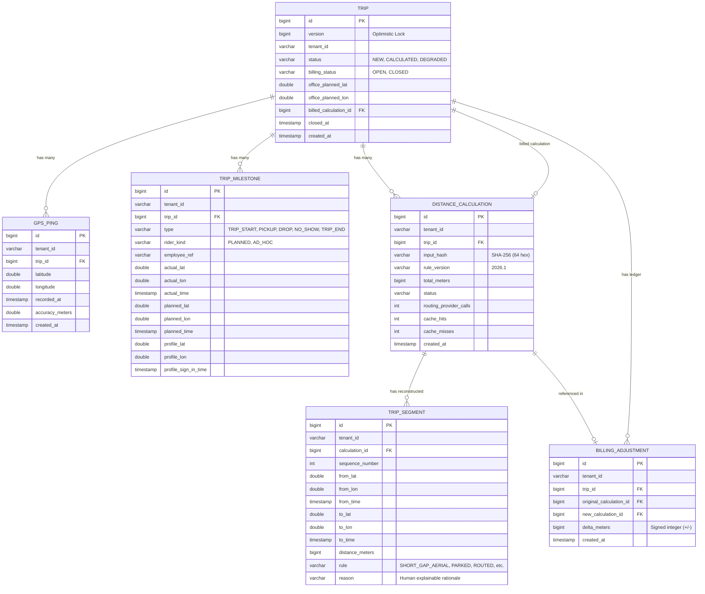
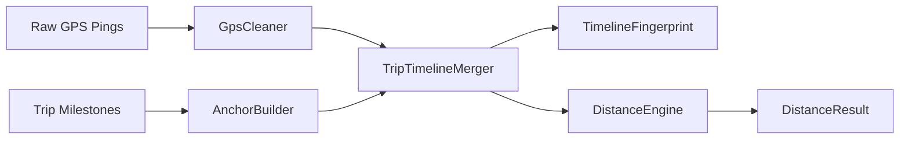
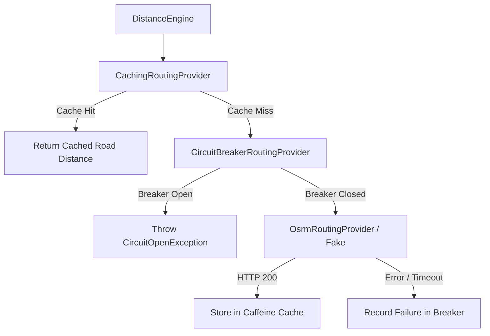
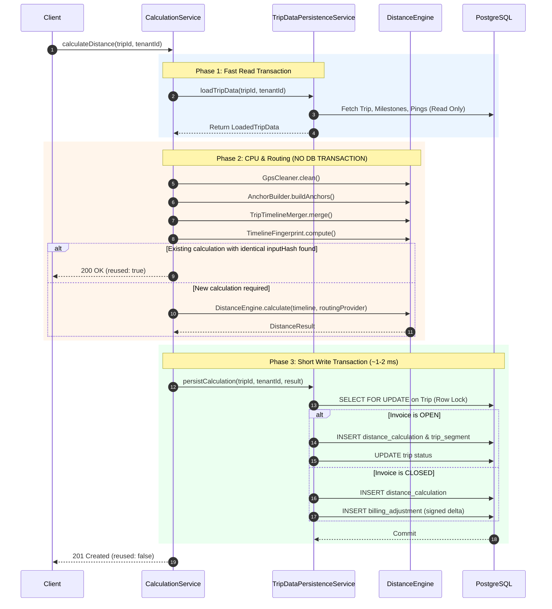

# GPS Distance Reconstruction Engine — Technical Code Documentation

A comprehensive technical architecture, code design, and operational manual for the **GPS Distance Reconstruction Engine**, a backend service built with **Java 21** and **Spring Boot 3.5.x**.

---

## Table of Contents
1. [System Overview & Core Philosophy](#1-system-overview--core-philosophy)
2. [Technology Stack](#2-technology-stack)
3. [Package & Directory Architecture](#3-package--directory-architecture)
4. [Domain Model & Database Schema](#4-domain-model--database-schema)
5. [The Algorithmic Reconstruction Engine (`engine`)](#5-the-algorithmic-reconstruction-engine-engine)
6. [Routing, Caching & Circuit Breaker (`routing`)](#6-routing-caching--circuit-breaker-routing)
7. [Service Layer & 3-Phase Calculation Pattern (`service`)](#7-service-layer--3-phase-calculation-pattern-service)
8. [Security, Roles & Multi-Tenant Isolation (`security`)](#8-security-roles--multi-tenant-isolation-security)
9. [REST API Reference (`api`)](#9-rest-api-reference-api)
10. [Background Jobs & Eventual Consistency (`job`)](#10-background-jobs--eventual-consistency-job)
11. [Configuration Reference (`config`)](#11-configuration-reference-config)
12. [Testing Architecture & Verification](#12-testing-architecture--verification)
13. [Operational Runbook & Getting Started](#13-operational-runbook--getting-started)

---

## 1. System Overview & Core Philosophy

### Problem Statement
In corporate employee transport systems (e.g., MoveInSync), cab vendors are compensated strictly on a **per-kilometer** basis. However, raw telematics data transmitted from low-cost GPS hardware or smartphones is plagued with real-world sensor defects:
- **Missing or delayed signals** (underpasses, parking basements, carrier network drops).
- **Out-of-order and duplicate pings** caused by network retries.
- **Multipath reflections and "teleport jumps"** where GPS devices falsely report speeds exceeding $200\text{ km/h}$.
- **Driver detours, early trip terminations, or stops outside office boundaries**.

### Core Architecture Philosophy
1. **Clean Architecture / Hexagonal Isolation**:
   The core algorithmic reconstruction logic in [`com.example.gpsengine.engine`](file:///src/main/java/com/example/gpsengine/engine) is **100% pure Java**. It has zero dependencies on Spring Boot, Jakarta JPA, Hibernate, or network clients. This ensures the calculation rules can be unit-tested in sub-milliseconds without firing up a database or container.
2. **Audit-Proof Financial Ledger**:
   Once an invoice is finalized (`close-invoice`), the billed calculation is immutable. If late-arriving pings are ingested later, the original billed record is never silently mutated; instead, a signed delta is recorded in a `BillingAdjustment` ledger.
3. **Deterministic Integer Precision**:
   To prevent binary floating-point drift across platforms ($0.1 + 0.2 \ne 0.3$), each segment distance is rounded once using `Math.round()` to whole meters and stored as a `long`. The trip total is an exact integer sum.
4. **Non-Blocking External I/O**:
   Database transactions are strictly separated from CPU-heavy algorithms and external network routing calls. Locks are never held across HTTP calls to external routing providers.

---

## 2. Technology Stack

| Component | Technology | Version | Purpose |
| :--- | :--- | :--- | :--- |
| **Language** | Java | 21 (LTS) | Virtual threads support, pattern matching, records |
| **Framework** | Spring Boot | 3.5.x | Web, Validation, Data JPA, Security |
| **Database** | PostgreSQL | 16-alpine | Primary relational store (Dockerised dev port `5434`) |
| **In-Memory Cache**| Caffeine | 3.x | Snapped-grid route cache with TinyLFU eviction |
| **JWT Library** | Nimbus JOSE+JWT | Built-in Spring | HMAC-SHA256 stateless token decoding |
| **Testing** | JUnit 5, AssertJ, Mockito | Latest | 222 automated tests, 4 JUnit 5 tag groups |
| **Routing Engine**| OSRM / Custom Fake | HTTP / In-memory | Road network shortest path calculations |

---

## 3. Package & Directory Architecture

```
com.example.gpsengine
├── api                 # REST Controllers, DTO Records, Request/Response Mappings
│   └── dto             # Immutable Java Record DTOs with Bean Validation
├── config              # Spring Configuration beans and properties mapping
├── domain              # JPA Entities, Enums, and Domain Factory
├── engine              # Pure Java Algorithmic Core (NO Spring/DB dependencies)
├── error               # Custom Exceptions and Global Exception Handler
├── job                 # Scheduled Background Workers (Degraded trip recompute)
├── monitoring          # Micrometer Actuator metrics collection
├── repository          # Spring Data JPA Repositories
├── routing             # OSRM client, Snapped-Grid Caffeine cache, Circuit Breaker
├── security            # Stateless JWT auth, Tenant Argument Resolver, RBAC
└── service             # Business logic orchestration & 3-phase calculation pattern
```

### Module Responsibilities

| Package | Responsibility |
| :--- | :--- |
| [`api`](file:///src/main/java/com/example/gpsengine/api) | Exposes versioned REST endpoints (`/api/v1/trips`, `/api/v1/auth`). Translates HTTP requests into service calls and maps domain models to sanitized DTOs. |
| [`config`](file:///src/main/java/com/example/gpsengine/config) | Defines configuration properties (`@ConfigurationProperties`) and provides canonical configuration fingerprinting for cache/idempotency keys. |
| [`domain`](file:///src/main/java/com/example/gpsengine/domain) | Contains the 6 relational JPA entities, database constraints, enums (`TripStatus`, `BillingStatus`, `SegmentRule`), and audit fields. |
| [`engine`](file:///src/main/java/com/example/gpsengine/engine) | Plain-Java domain engine: GPS noise cleaning, milestone anchor synthesis, timeline merging, Haversine spherical math, segment rule engine, and SHA-256 fingerprinting. |
| [`error`](file:///src/main/java/com/example/gpsengine/error) | Centralized error handling. Maps domain exceptions to standard RFC 7807/custom JSON errors (`ErrorResponse`). |
| [`job`](file:///src/main/java/com/example/gpsengine/job) | Background `@Scheduled` task that monitors `DEGRADED` trips and recomputes them once upstream map services recover. |
| [`monitoring`](file:///src/main/java/com/example/gpsengine/monitoring) | Micrometer metrics for telemetry (route cache hit ratio, calculation timings, circuit breaker state transitions). |
| [`repository`](file:///src/main/java/com/example/gpsengine/repository) | Spring Data JPA interfaces. Every query strictly enforces tenant isolation (`findBy...AndTenantId`). |
| [`routing`](file:///src/main/java/com/example/gpsengine/routing) | Decorated routing pipeline implementing `RoutingProvider`: `CachingRoutingProvider` $\to$ `CircuitBreakerRoutingProvider` $\to$ `OsrmRoutingProvider`. |
| [`security`](file:///src/main/java/com/example/gpsengine/security) | Nimbus JWT verification, `CurrentUserArgumentResolver`, multi-tenant security filters, and constant-time BCrypt authentication. |
| [`service`](file:///src/main/java/com/example/gpsengine/service) | Orchestrates the 3-phase calculation, handles optimistic/pessimistic locking, trip lifecycle, and billing adjustment ledgering. |

---

## 4. Domain Model & Database Schema

The database model is centered on 6 primary entities. Every table carries a `tenant_id` column to guarantee complete logical multi-tenancy.



### Database Constraints & Data Integrity Safeguards
- **`uk_calc_trip_hash_ver_status`**: Unique constraint on `distance_calculation (trip_id, input_hash, rule_version, status)`. Prevents duplicate calculation records during concurrent execution.
- **`uk_adjustment_trip_new_calc`**: Unique constraint on `billing_adjustment (trip_id, new_calculation_id)`. Ensures a single calculation can trigger at most one ledger adjustment.
- **Optimistic Locking**: `@Version private Long version` on `Trip` ensures race-free administrative updates.
- **Pessimistic Locking**: `PESSIMISTIC_WRITE` row-level locks on `Trip` serialize write operations during Phase 3 of calculation.

---

## 5. The Algorithmic Reconstruction Engine (`engine`)

The [`com.example.gpsengine.engine`](file:///src/main/java/com/example/gpsengine/engine) package is the mathematical heart of the application.



### 1. `GpsCleaner.java`
Filters noisy and corrupted raw GPS streams using a deterministic 5-step pipeline:
1. **Invalid Coordinate Elimination**: Discards coordinates outside latitude $[-90, 90]$ or longitude $[-180, 180]$, `NaN`, infinity, or exact `(0, 0)` fixes.
2. **Deterministic Pre-sorting**: Chronologically sorted by `timestamp`. Ties broken by `accuracyMeters` (nulls last), then `latitude`, then `longitude`.
3. **Deduplication**: Rounds coordinates to 6 decimal places ($\approx 0.11\text{m}$). Keeps the most accurate fix for identical timestamps and locations.
4. **Accuracy Threshold Filtering**: Drops pings with uncertainty $> 50.0\text{m}$ (`accuracyThresholdMeters`). Pings with `null` accuracy are preserved.
5. **Teleport Rejection**: Discards points with implied Haversine speed $> 120\text{ km/h}$ evaluated **against the last accepted valid point**.

### 2. `AnchorBuilder.java`
Synthesizes business ground truths into the timeline after GPS cleaning:
- **Employee Pickups & Drops**:
  1. *Priority 1*: Actual driver recording at pickup location (`EMPLOYEE_ACTUAL`).
  2. *Priority 2 (Ad-Hoc)*: Employee profile home location + sign-in time (`EMPLOYEE_PROFILE_FALLBACK`).
  3. *Priority 3 (Planned)*: Scheduled pickup location + planned time (`EMPLOYEE_PLANNED_FALLBACK`).
- **No-Show Anchors**: Synthesized when `includeNoShow = true`.
- **Office Anchor (400-Meter Rule)**:
  - If actual trip-end location is within **$\le 400\text{ meters}$** of planned office, use `OFFICE_ACTUAL`.
  - If driver finished $> 400\text{ meters}$ away, snap to `OFFICE_PLANNED`.

### 3. `TripTimelineMerger.java`
Merges cleaned GPS points and synthetic milestone anchors into a single immutable `List<TripPoint>`.
**Deterministic 4-level tie-breaking**:
1. Timestamp ascending.
2. Origin: `GPS` precedes `ANCHOR` at identical timestamps.
3. AnchorSource natural enum order.
4. Latitude ascending, then Longitude ascending.

### 4. `HaversineCalculator.java`
Calculates great-circle distance between two latitude/longitude coordinates on a spherical Earth:
$$\text{Earth Radius } R = 6,371,000\text{ meters}$$
Implemented using `Math.atan2` for numerical stability across micro-distances. Time complexity: $O(1)$.

### 5. `DistanceEngine.java` (Rule Decision State Machine)
Evaluates each consecutive pair $(P_i, P_{i+1})$:
- **Rule 1 (`SHORT_GAP_AERIAL`)**: Time gap $< 70\text{s}$ and speed $\le 120\text{ km/h}$. Road curvature is negligible; straight-line distance is used.
- **Rule 2 (`PARKED`)**: Time gap $\ge 70\text{s}$ and speed $< 5\text{ km/h}$. Vehicle is idling or stuck in traffic; straight-line displacement used.
- **Rule 3 (`REJECTED_SPEED` - Pre-Check)**: If straight-line speed $> 120\text{ km/h}$, reject immediately with $0\text{ meters}$ **without querying routing provider**.
- **Rule 4 (`ROUTED`)**: Queries routing provider.
  - If provider fails, times out, or circuit breaker is open $\to$ fallback to **$\text{straightMeters} \times 1.4$** (`FALLBACK_AERIAL_1_4`) and mark trip `DEGRADED`.
  - If routed distance $> 100\text{ km}$ $\to$ `REJECTED_MAX_DISTANCE` ($0\text{m}$).
  - If both routed speed and aerial $\times 1.4$ speed $> 120\text{ km/h}$ $\to$ `REJECTED_SPEED` ($0\text{m}$).
  - Otherwise $\to$ accept routed road meters (`ROUTED`).

### 6. `TimelineFingerprint.java`
Generates a canonical 64-character hexadecimal SHA-256 hash:
- Uses `Double.doubleToLongBits()` for coordinates to eliminate floating-point string format and locale differences.
- Encodes epoch seconds and nanoseconds.
- Computed **after GPS cleaning and anchor synthesis**, guaranteeing that discarded duplicate or late noisy pings yield identical fingerprints.

---

## 6. Routing, Caching & Circuit Breaker (`routing`)



### Architectural Pipeline
1. **`CachingRoutingProvider.java`**:
   - In-memory Caffeine cache capped at 100,000 entries with a 24-hour TTL.
   - **Grid Snapping**: Coordinates snap to $\approx 110\text{m}$ grid cells (`0.001` degrees). Queries use the cell center, ensuring deterministic cache hits across concurrent threads while limiting endpoint displacement to $\le 78\text{m}$.
   - **Availability Decision**: Sits *outside* the circuit breaker. Even during upstream outages, frequent commute routes continue serving from cache.
2. **`CircuitBreakerRoutingProvider.java` & `CircuitBreaker.java`**:
   - Hand-written finite state machine (`CLOSED`, `OPEN`, `HALF_OPEN`).
   - If failure threshold is reached (e.g. 5 consecutive timeouts), transitions to `OPEN`.
   - Rejects upstream calls immediately with `CircuitOpenException` until reset timeout elapses.
3. **`OsrmRoutingProvider.java`**:
   - Queries Open Source Routing Machine (`/route/v1/driving/{lon1},{lat1};{lon2},{lat2}?overview=false`).
   - Uses configured socket connect and read timeouts (default: 2000 ms).

---

## 7. Service Layer & 3-Phase Calculation Pattern (`service`)

Distance calculations are executed via [`CalculationService.java`](file:///src/main/java/com/example/gpsengine/service/CalculationService.java) and [`TripDataPersistenceService.java`](file:///src/main/java/com/example/gpsengine/service/TripDataPersistenceService.java) to prevent connection pool exhaustion and lock contention.



---

## 8. Security, Roles & Multi-Tenant Isolation (`security`)

### 1. Stateless HMAC-SHA256 JWT Authentication
- Tokens are signed with HS256 using a minimum 256-bit secret.
- **Claims**: `sub` (User ID), `tenant` (Tenant ID), `role` (`ADMIN`, `OPERATOR`, `EMPLOYEE`), `employeeRef`, `exp` (15-minute TTL), `jti` (UUID).
- Zero database lookups during token authentication for horizontal scalability.

### 2. Role-Based Access Control (RBAC) Matrix

| Endpoint | Method | Public | EMPLOYEE | OPERATOR | ADMIN |
| :--- | :--- | :---: | :---: | :---: | :---: |
| `/api/v1/auth/login` | `POST` | Yes | Yes | Yes | Yes |
| `/api/v1/hello` | `GET` | Yes | Yes | Yes | Yes |
| `/api/v1/trips` | `POST` | No | 403 Forbidden | 201 Created | 201 Created |
| `/api/v1/trips/{id}/pings` | `POST` | No | 403 Forbidden | 201 Created | 201 Created |
| `/api/v1/trips/{id}/milestones` | `POST` | No | 403 Forbidden | 201 Created | 201 Created |
| `/api/v1/trips/{id}/calculations` | `POST` | No | 403 Forbidden | 201 / 200 OK | 201 / 200 OK |
| `/api/v1/trips/{id}/close-invoice` | `POST` | No | 403 Forbidden | 403 Forbidden | 200 OK |
| `/api/v1/trips/{id}` | `GET` | No | Summary Only* | 200 OK (Full) | 200 OK (Full) |
| `/api/v1/trips/{id}/calculations` | `GET` | No | 403 Forbidden | 200 OK | 200 OK |
| `/api/v1/trips/{id}/calculations/{calcId}/segments` | `GET` | No | 403 Forbidden | 200 OK | 200 OK |
| `/api/v1/trips/{id}/billing-adjustments` | `GET` | No | 403 Forbidden | 200 OK | 200 OK |

*\* Note on Employee Access: Employees can only view trips they participated in (matching `employeeRef`). Only sanitized summaries (`id`, `status`, `latestTotalKm`) are visible; financial margins and raw coordinates are shielded.*

### 3. Multi-Tenant Isolation & The "Silent 404"
- The tenant ID is extracted directly from the validated cryptographic token via [`CurrentUserArgumentResolver.java`](file:///src/main/java/com/example/gpsengine/security/CurrentUserArgumentResolver.java). Incoming client headers like `X-Tenant-Id` are ignored.
- **Silent 404**: If tenant A probes trip ID `42` belonging to tenant B, the service returns **`404 RESOURCE_NOT_FOUND`**, identical to a non-existent trip. Returning `403 FORBIDDEN` would leak intelligence confirming the existence of resources across tenant boundaries.

### 4. Privacy Invariants (GDPR / PII)
- `toString()` methods on all DTO records (`PingDto`, `MilestoneDto`, `TripPoint`) omit raw GPS coordinates and employee IDs.
- Loggers are verified via regression test to ensure zero coordinates or tokens leak to disk.

---

## 9. REST API Reference (`api`)

Base URL: `/api/v1`  
All secured endpoints require: `Authorization: Bearer <token>`

### 1. `POST /api/v1/auth/login`
Authenticates user and returns an HS256 JWT access token.
```json
// Request
{
  "username": "operator-a",
  "password": "YourStrongPassword123!"
}

// Response: 200 OK
{
  "accessToken": "eyJhbGciOiJIUzI1NiJ9...",
  "tokenType": "Bearer",
  "expiresIn": 900,
  "role": "OPERATOR",
  "tenantId": "tenant-a"
}
```

### 2. `POST /api/v1/trips`
Creates a new trip.
```json
// Request
{
  "officePlannedLatitude": 12.9279,
  "officePlannedLongitude": 77.6271
}

// Response: 201 Created (Location: /api/v1/trips/1)
{
  "id": 1,
  "tenantId": "tenant-a",
  "status": "NEW",
  "billingStatus": "OPEN",
  "officePlannedLatitude": 12.9279,
  "officePlannedLongitude": 77.6271,
  "createdAt": "2026-10-31T05:00:00Z"
}
```

### 3. `POST /api/v1/trips/{id}/pings`
Ingests a batch of raw GPS coordinates (1 to 10,000 pings).
```json
// Request
{
  "pings": [
    {
      "latitude": 12.9716,
      "longitude": 77.5946,
      "recordedAt": "2026-10-31T05:00:00Z",
      "accuracyMeters": 10.5
    }
  ]
}

// Response: 201 Created
{
  "accepted": 1
}
```

### 4. `POST /api/v1/trips/{id}/milestones`
Ingests 1 to 500 milestones (`TRIP_START`, `PICKUP`, `DROP`, `NO_SHOW`, `TRIP_END`).
```json
// Request
{
  "milestones": [
    {
      "type": "TRIP_START",
      "actualTime": "2026-10-31T05:00:00Z"
    },
    {
      "type": "PICKUP",
      "riderKind": "PLANNED",
      "employeeRef": "emp-101",
      "actualLatitude": 12.9720,
      "actualLongitude": 77.5950,
      "actualTime": "2026-10-31T05:10:00Z"
    },
    {
      "type": "TRIP_END",
      "actualLatitude": 12.9280,
      "actualLongitude": 77.6270,
      "actualTime": "2026-10-31T05:45:00Z"
    }
  ]
}

// Response: 201 Created
{
  "accepted": 3
}
```

### 5. `POST /api/v1/trips/{id}/calculations`
Executes idempotent distance reconstruction.
- Returns `201 Created` (`reused: false`) on fresh calculation.
- Returns `200 OK` (`reused: true`) if timeline fingerprint matches an existing run.

```json
// Response: 201 Created / 200 OK
{
  "id": 14,
  "tripId": 1,
  "status": "CALCULATED",
  "ruleVersion": "2026.1",
  "totalMeters": 14250,
  "totalKm": 14.250,
  "routingProviderCalls": 3,
  "cacheHits": 2,
  "cacheMisses": 3,
  "reused": false,
  "createdAt": "2026-10-31T05:46:00Z"
}
```

### 6. `POST /api/v1/trips/{id}/close-invoice` (ADMIN only)
Locks the latest `CALCULATED` distance as the final billed figure.
```json
// Response: 200 OK
{
  "id": 1,
  "status": "CALCULATED",
  "billingStatus": "CLOSED",
  "billedMeters": 14250,
  "billedKm": 14.250,
  "closedAt": "2026-10-31T05:50:00Z"
}
```

---

## 10. Background Jobs & Eventual Consistency (`job`)

### `DegradedTripRecomputeJob.java`
- Runs periodically via Spring `@Scheduled` (`job.degraded-recompute.cron`).
- **Circuit Breaker Gate**: Checks whether `RoutingProvider.isAvailable()`. If the upstream provider is still failing, the job skips execution to avoid wasting CPU.
- **Safe Recovery**: Finds trips in `DEGRADED` status and recomputes them. Once the road network router responds successfully, the trip transitions to `CALCULATED`, updating the calculation without user intervention.

---

## 11. Configuration Reference (`config`)

### Key Application Properties (`application.properties`)

```properties
# Server
server.port=8081

# PostgreSQL Database
spring.datasource.url=jdbc:postgresql://localhost:5434/gps_engine
spring.datasource.username=gps_user
spring.datasource.password=gps_pass
spring.jpa.hibernate.ddl-auto=update

# GPS Cleaning Configuration
gps.cleaning.accuracy-threshold-meters=50.0
gps.cleaning.max-speed-kmh=120.0

# Anchor Configuration
anchor.office-radius-meters=400.0
anchor.include-no-show=false

# Segment Reconstruction Configuration
segment.short-gap-seconds=70
segment.parked-speed-kmh=5.0
segment.max-speed-kmh=120.0
segment.fallback-multiplier=1.4
segment.max-route-meters=100000.0

# Routing & Cache
routing.provider.type=osrm
routing.osrm.base-url=http://localhost:5000
routing.cache.ttl-hours=24
routing.cache.max-entries=100000
routing.circuit-breaker.failure-threshold=5
routing.circuit-breaker.reset-timeout-seconds=60

# Background Jobs
job.degraded-recompute.enabled=true
job.degraded-recompute.cron=0 */5 * * * *
```

---

## 12. Testing Architecture & Verification

The repository contains an automated test suite of **222 tests** across 38 classes categorized via JUnit 5 `@Tag` annotations:

```powershell
# Run pure unit tests (plain-Java, 116 tests, ~10s, NO Docker)
.\mvnw.cmd test "-Dgroups=unit"

# Run integration tests (Spring context, PostgreSQL container, 106 tests)
.\mvnw.cmd test "-Dgroups=integration"

# Run multithreaded concurrency tests (50-thread stampede, 4 tests)
.\mvnw.cmd test "-Dgroups=concurrency"

# Run failure injection tests (outages, circuit breaker trip/reset, 9 tests)
.\mvnw.cmd test "-Dgroups=failure-injection"

# Run full test suite (All 222 tests)
.\mvnw.cmd test
```

---

## 13. Operational Runbook & Getting Started

### Prerequisites
- **Java 21 JDK** installed (`java -version`).
- **Docker Desktop** installed and running.

### 1. Launch PostgreSQL Container
```powershell
docker compose up -d
```
Verify container status:
```powershell
docker compose ps
```

### 2. Configure Environment Variables
Copy `.env.example` to `.env`:
```env
JWT_SECRET=c29tZXNlY3JldGtleXdpdGhhYXRsZWFzdDMyYnl0ZXNsb25nMTIzNDU2
AUTH_SEED_ENABLED=true
SEED_PASSWORD=YourStrongPassword123!
```

### 3. Build & Run Application
```powershell
.\mvnw.cmd spring-boot:run
```

### 4. Health Check
```powershell
curl.exe http://localhost:8081/api/v1/hello
# Output: {"status":"UP","service":"gps-distance-engine"}
```

