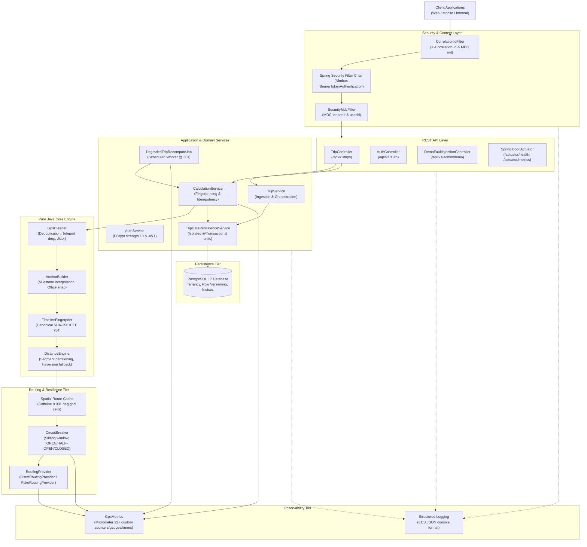
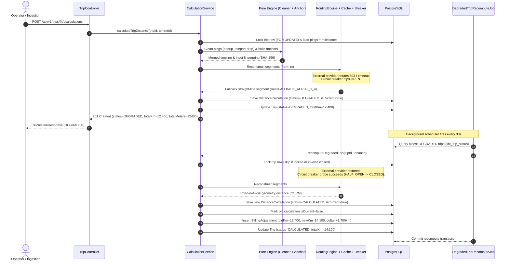
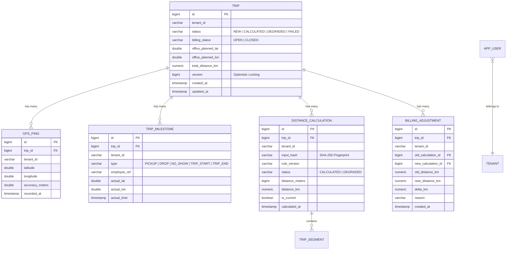

# System Architecture & Technical Design

This document details the architectural decisions, component interactions, data model, failure modes, and correctness guarantees of the **GPS Distance Reconstruction Engine**.

---

## 1. High-Level Architecture

The engine is built around a resilient pipeline that accepts noisy, real-world GPS streams and driver milestones, performs cleaning and anchor synthesis, reconstructs trip segments via an external routing provider or straight-line fallback, caches spatial queries, and automatically recovers degraded trips when provider connectivity is restored.

---

## 2. Sequence Diagram: Resilient End-to-End Flow

The following sequence illustrates the engine's hardest operational workflow:
1. Operator uploads raw pings and milestones.
2. Calculation service cleans and synthesizes the timeline.
3. External routing provider fails; circuit breaker opens; trip calculates with straight-line fallback (`DEGRADED`).
4. Automatic recompute job detects degraded trip when provider recovers, recalculates road-network distance, and records an immutable `BillingAdjustment`.

---

## 3. Failure Mode & Resilience Matrix

| Failure Mode | System Response | Recovery Mechanism | Verified In Test |
| :--- | :--- | :--- | :--- |
| **Routing Provider Outage / HTTP 5xx** | Circuit breaker opens; calls immediately fallback to straight-line Haversine distance multiplied by 1.4. | Calculation completes successfully with status `DEGRADED`; trip queued for recompute. | `FailureInjectionIntegrationTest#testExternalRoutingFailureTriggersCircuitBreakerAndDegradedStatus` |
| **Concurrent Calculation Requests** | Database optimistic locking (`@Version`) and row locking prevent double-calculation. Fingerprint check returns cached calculation if fingerprint matches. | Second concurrent request receives `reused=true` (HTTP 200) or clean 409 Conflict retry. | `AdvancedConcurrencyIntegrationTest#testConcurrentRecalculationsWithIdenticalFingerprint` |
| **Late Out-of-Order Pings Ingested (Open Trip)** | Re-calculation triggers fingerprint recompute. Fingerprint changes $\to$ new calculation created. | Prior calculation marked `isCurrent=false`; trip total updated atomically. | `LatePingsAndBillingAdjustmentIntegrationTest#latePingsAndAdjustmentIntegrity` |
| **Late Pings Ingested (Closed Invoice)** | Billed calculation remains locked and immutable. Re-calculation creates a new calculation and signed delta record. | Ledger records `BillingAdjustment` with signed `deltaMeters`; financial auditability guaranteed. | `LatePingsAndBillingAdjustmentIntegrationTest#latePingsAndAdjustmentIntegrity` |
| **High Jitter / Teleporting GPS Glitch** | Cleaner filters pings exceeding speed threshold ($> 120$ km/h) or low accuracy ($> 50$m). | Pings dropped prior to timeline synthesis; discarded count logged in metrics. | `GpsCleanerTest#testTeleportPingsAreDropped` |
| **Cross-Tenant Data Tampering** | All queries enforce `tenantId = :tenantId`. Mismatch throws 404 Resource Not Found. | Cross-tenant access impossible even for ADMIN users operating within a specific tenant context. | `SecurityRoleMatrixTest#crossTenantAccessIsBlocked` |
| **Database Connection Failure** | HikariCP pool handles reconnect; Spring transaction rolls back atomically. | HTTP 500 returned with correlationId in header and body; zero partial commits. | `ActuatorSecurityAndPrivacyIntegrationTest#logsContainNoPersonalDataOrSecrets` |

---

## 4. Data Model Summary

### Key Performance Indices
- `idx_trip_tenant_status`: Compound index on `(tenant_id, status)` for fast operator filtering.
- `idx_trip_status`: Dedicated index on `trip.status` enabling high-throughput polling by `DegradedTripRecomputeJob` without full-table scans.
- `uk_calc_trip_hash_ver_status`: Unique constraint preventing duplicate calculations for identical inputs.

---

## 5. Caching Staleness & Invalidation Guarantee

The spatial route cache operates under a mathematical immutability guarantee:

1. **Deterministic Grid Quantization:**
   Coordinate pairs are rounded to fixed spatial grid cells:
   $$\text{cell}(\text{lat}, \text{lon}) = \left(\text{round}\left(\frac{\text{lat}}{\Delta}\right) \times \Delta, \; \text{round}\left(\frac{\text{lon}}{\Delta}\right) \times \Delta\right)$$
   Where $\Delta = 0.001^\circ \approx 111$ meters.

2. **Immutable Physical Distance:**
   The road-network driving distance between two static physical locations on Earth is time-invariant over operational time windows (hours to days). Road networks do not physically move.

3. **Zero Staleness Guarantee:**
   Because cache keys depend solely on quantized geometric coordinates and vehicle routing profiles—never on timestamps, driver IDs, or trip state—a cached distance for segment $(A, B)$ can **never become stale** or incorrect for any future trip traversing the same spatial corridor.

